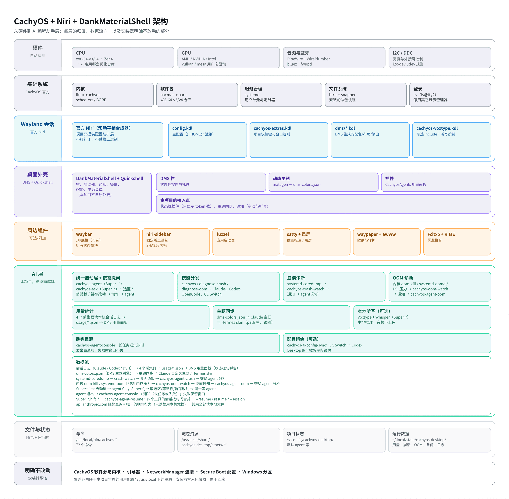

# 系统构成与文件布局



上图是完整的层级与数据流。源文件是 `docs/images/architecture.svg`，由
[make-architecture.py](make-architecture.py) 生成（改结构后重跑一次脚本即可，不要手改 SVG）。

一句话概括：**CachyOS 基础系统 → 官方 Niri 会话 → DMS/Quickshell 外壳 → 周边组件**，
AI 编程助手作为**独立的一层**挂在旁边，只通过“配置文件、桌面通知、本地状态文件”与桌面交互，
不依赖桌面也能单独使用。

<details>
<summary>纯文本版（便于终端里阅读与 grep，内容与上图一致）</summary>

```text
CachyOS（Arch 派生，x86-64-v3/v4 优化仓库 + linux-cachyos 内核）
└── 官方 Niri（Wayland 滚动平铺合成器，项目只提供配置，不打补丁）
    ├── DankMaterialShell + Quickshell   栏、启动器、通知、锁屏、动态主题
    ├── Waybar ×2                        顶栏与底栏（可选：机器上跑 DMS 自带栏时不启动）
    ├── Kitty                            默认终端
    ├── Fcitx5 + RIME（雾凇拼音）         中文输入
    └── Ly（ly@tty2.service）            登录管理器（安装器会停用其它显示管理器）

AI 编程助手层（与桌面解耦，可单独使用）
├── agent 启动层        Super+` 启动默认 agent；多个则弹选择器
├── 技能分发            cachyos / diagnose-crash / diagnose-oom 软链进 Claude、Codex、OpenCode、CC Switch
├── 崩溃诊断            systemd-coredump 监听 + 一键交给 agent 分析
├── OOM 诊断            内核 memcg / systemd-oomd / PSI 内存压力监听 + 一键交给 agent 分析
├── 用量面板            Claude / Codex / OpenCode / DSH 的 token 与费用（状态栏默认只显示数字）
├── 主题同步            把 DMS 的明暗与完整配色推给 agent
├── 本地听写（可选）    Voxtype + Whisper，Super+'（或 Super+F9）开始/结束
└── 配置镜像（可选）    CC Switch ↔ Codex Desktop 的非敏感字段镜像

数据流
├── 会话日志(claude/codex/dsh) → 3 个采集器 → usage/*.json → DMS 用量面板（面板登记 4 个 agent）
├── dms-colors.json → 主题同步 → Claude 自定义主题 / Hermes skin
├── systemd-coredump → crash-watch → 通知 → cachyos-agent-crash → agent 分析
├── 内存压力/OOM 事件 → oom-watch → 通知 → cachyos-agent-oom → agent 分析
└── api.anthropic.com 限额查询 = 唯一的联网行为（只读复用本机凭据）
```

</details>

## 分层职责

| 层 | 由谁提供 | 本项目负责 |
| --- | --- | --- |
| 基础系统 | CachyOS | 预检、系统升级、CPU/GPU 检测与微码/驱动包选择 |
| 合成器 | 官方 Niri | 主配置、扩展、快捷键；不打补丁、不装 fork |
| 桌面外壳 | DMS + Quickshell | 固定版本安装、DMS 设置、动态配色、锁屏与电源策略 |
| 周边组件 | Waybar、Kitty、Fcitx5、Ly 等 | 配置模板、服务绑定与首次登录初始化 |
| 应用 | 仓库 + AUR | 包清单（`packages.sh`）与安装顺序 |
| AI 层 | 本项目的脚本与 DMS 插件 | 启动、提问、续接、用量、崩溃/OOM、主题、配置镜像；不改 agent 本身 |

各层的使用说明见[文档索引](README.md)：桌面见 [desktop.md](desktop.md)，快捷键见
[keybindings.md](keybindings.md)，AI 层见 [ai.md](ai.md)。

## 仓库结构

| 路径 | 内容 |
| --- | --- |
| `install.sh` | 安装器主流程（六段阶段：环境检查、系统更新、硬件与服务、应用与桌面、桌面配置与 AI 组件、服务启用与收尾） |
| `packages.sh` | 仓库包与 AUR 包清单，是默认应用的唯一来源 |
| `hardware.sh` | CPU/GPU 检测与硬件相关包选择，安装器与 `verify.sh` 共用 |
| `verify.sh` | 安装后验收（命令、配置、服务、插件、首次登录标记） |
| `bin/` | 仓库内的 73 个命令：72 个 `cachyos-*` 与 `terminal-here`；安装后 `/usr/local/bin` 共 74 个本项目命令（另有 Go 编写的 `cachyos-usage-json`，不在 `bin/` 里） |
| `assets/` | 配置模板、脚本库、agent 技能、DMS 插件、Go 源码与预编译 helper |
| `assets/go-bin/` | 7 个随包 Go helper：AI 设置/用量 2 个 + 插件 helper 5 个 |
| `go/` | AI 设置与用量 JSON 的 Go 源码 |
| `tools/` | `build-go-helpers.sh` 与 `install-go-helpers.sh` |
| `tests/` | 可离线运行的回归测试；`tests/run-all.sh` 是统一入口 |
| `docs/` | 模块文档、截图与架构图生成脚本 |

## 安装后的主要文件位置

| 路径 | 内容 |
| --- | --- |
| `/usr/local/bin/cachyos-*` 等 | 本项目安装的 74 个命令：`cachyos-*` 73 个（`agent`、`usage-*`、`voxtype-*`、`crash-*`、`oom-*` 等），另加 `terminal-here` |
| `/usr/local/share/cachyos-desktop/assets/**` | 随包资源：技能、DMS 插件、配置模板、脚本库 |
| `/usr/local/share/cachyos-desktop/config-manifest.tsv` | 受管配置清单，驱动 `cachyos-config` |
| `~/.config/niri/` | 主配置、`cachyos-extras.kdl` 扩展；`dms/` 下由 DMS 生成的配色/布局/光标/模糊，以及安装器写入的 `binds.kdl` |
| `~/.config/waybar/` | 顶栏、底栏与样式 |
| `~/.config/DankMaterialShell/` | DMS 设置，以及 `plugins/` 下随包的 7 个插件（AI 集成、本机状态、离线翻译、本地歌词、手机连接、专注、Top 系统面板） |
| `~/.config/cachyos-desktop/` | 本项目自身状态（默认 agent、AI 设置、问一问提示词） |
| `~/.local/state/cachyos-desktop/` | 用量记录、崩溃与 OOM 记录、首次登录日志、配置备份、受保护配置清单 |
| `~/.config/systemd/user/cachyos-*` | 6 个用户单元：崩溃监听、OOM 监听、主题 path 与 service、用量 service 与 timer |
| `~/.claude/`、`~/.codex/`、`~/.dsh/` 等 | 技能软链与 agent 配置镜像 |
| `docs/`（仓库内） | 模块文档；`docs/images/` 放截图与架构图 |

完整的命令清单不需要在文档里维护：安装后 `ls /usr/local/bin/` 里本项目的命令就是全部，
`<命令> --help` 都带中文用法说明。各模块的详细说明以 [docs/](README.md) 下的对应页面为准。
