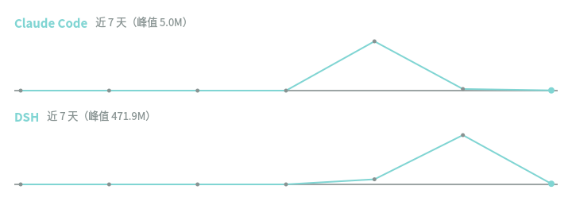

# 界面预览

> 截图来自本机真实运行。为保护隐私，截图里的窗口标题与本机网络信息已裁掉。

## 状态栏与 AI 用量

底栏右侧是本项目的 AI 用量控件（下图最右端 `56.0M`）：**默认只显示数字**——不带“今天/近 7 天”
这类前缀，也不显示图标和金额（想把日期前缀加回来，在插件设置里改「状态栏显示」即可）；点开可看
每个 agent 的明细。


放大后的用量控件：


弹窗里的近 7 天折线图（离屏渲染，数据取自本机真实用量记录；Claude Code 峰值 5.0M，
DSH 峰值 471.9M）：



用量面板的取数与语义见 [usage.md](usage.md)，面板设置见 [ai.md](ai.md#ai-集成面板)。

## 安装器界面

真终端里输出横幅、六段阶段进度、每组应用的进度条与收尾汇总；输出被重定向到文件或管道时自动
退化为纯文本（保留 `[INFO]`/`[WARN]`/`[DRY-RUN]` 标记）：

```text
╭─────────────────────────────────────────────────────────────────────────────────────────────────╮
│ CachyOS · Niri · DankMaterialShell                                                              │
│ 在已安装的 CachyOS 上部署 Niri 与 DankMaterialShell，并配置 AI 编程助手                         │
│ 以具备 sudo 权限的普通用户运行；需要网络连接                                                    │
│ 不改动软件源、引导器、网络连接与 Secure Boot                                                    │
╰─────────────────────────────────────────────────────────────────────────────────────────────────╯

== 阶段 1/6 · 检查环境 ----------------------------------------------------------------------------
╭─────────────────────────────────────────────────────────────────────────────────────────────────╮
│ CachyOS + Niri + DMS 安装计划                                                                   │
│ 运行用户          skynit                                                                        │
│ 终端              kitty                                                                         │
│ DMS 版本          v1.6.2                                                                        │
│ 系统升级          否（--skip-update）                                                           │
│ 检测到的硬件      已跳过（--skip-hardware）                                                     │
│ 硬件驱动栈        已跳过                                                                        │
│ 覆盖配置          是（覆盖受管理的用户配置）                                                    │
│ DMS 集成          DankSearch、DankCalendar                                                      │
│ 应用分组          daily、Chinese、office、development、media、VM、gaming、tools                 │
│ 显示管理器        Ly                                                                            │
```

安装选项与阶段说明见 [install.md](install.md)；桌面组件见 [desktop.md](desktop.md)。
