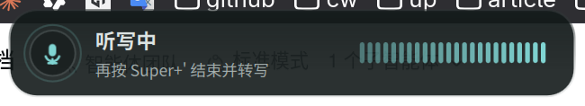
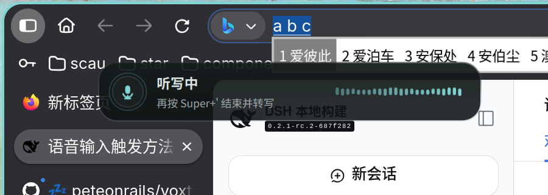

# 本地听写（可选）

基于 [Voxtype](https://github.com/peteonrails/voxtype) 1.1.0，本地推理，**不上传音频**。
**刻意不装进默认安装**：语音模型体积不小（英文 142MB，多语言 466MB），听写也不是所有人的需求。
AI 层总览见 [ai.md](ai.md)。

## 安装与日常命令

```bash
cachyos-voxtype-install              # 装 voxtype-bin + wtype、下载模型、按需开 GPU、写好快捷键
cachyos-voxtype-install --model small --language zh \
    --prompt '以下是普通话的句子，请使用简体中文。'   # 一步装成中文听写
cachyos-voxtype-toggle               # 开始/结束听写（快捷键绑的就是它）
cachyos-voxtype-config               # 打开 voxtype 的交互式配置
cachyos-voxtype-model                # 交互式换模型
cachyos-voxtype-model medium         # 非交互切换到指定模型
cachyos-voxtype-status               # 输出 Waybar 的 JSON 状态（Waybar 没跑时看通知）
cachyos-voxtype-remove               # 卸载：删快捷键、备份配置、移除模型
```

## 中文听写必须换模型

上游默认模型是英文专用的 `base.en`，同一段中文会输出成
`Quinti en tiene chie poutz…` 这样的乱码拼音。`--model` / `--language` / `--prompt`
三个参数就是为这件事准备的（顺序上安装命令会**先写配置再下载**，否则下的还是英文模型）：

```bash
cachyos-voxtype-model small                      # 多语言模型，约 466MB
voxtype config set whisper.language zh           # 明确指定中文，比 auto 更稳
voxtype config set whisper.initial_prompt '以下是普通话的句子，请使用简体中文。'
systemctl --user restart voxtype
```

最后那条 `initial_prompt` 是**实测必要**的：Whisper 会说中文，但默认输出**繁体**
（`今天天氣不遜我們下午三點開會`）。加上简体提示词后，同一段音频的输出变成
`今天天气不错,我们下午三点开会。`。安装命令在检测到当前是 `*.en` 模型时，也会直接把这
几步打印出来。

本机实测数据（`voxtype transcribe` 转写 16kHz 单声道 WAV）：

| 场景 | 模型 | 结果 | 耗时 |
| --- | --- | --- | --- |
| 英文 `The quick brown fox jumps over the lazy dog.` | `base.en` | 完全正确 | 0.83s |
| 中文 `今天天气不错，我们下午三点开会。` | `base.en` | 乱码拼音（英文专用模型） | 0.91s |
| 同上 | `small` + `zh` | 繁体，字面正确 | 2.99s |
| 同上 | `small` + `zh` + 简体提示词 | **`今天天气不错,我们下午三点开会。`** | 3.06s（CPU）→ **1.07s（Vulkan GPU）** |

GPU 加速需要替换 `/usr/bin/voxtype`，因此必须由 `sudo` 执行：安装命令里已经带上了
`sudo voxtype setup gpu --enable`（不带 sudo 时它只会报 permission denied，然后静默留在
CPU 上，实测就是这个坑）。上游还编进了 9 个引擎（SenseVoice、Paraformer 等 CJK 专用引擎
在其列），可用 `voxtype info engines` 查看、`voxtype config set engine <名字>` 切换。

## 快捷键

安装后快捷键是 **`Super+'`** 与 **`Super+F9`**（都是开始/结束切换）。这两个键
写在 `~/.config/niri/cachyos-voxtype.kdl`，由主配置用 `include optional=true` 引入——
Niri 没有条件绑定，用可选 include 才能做到“**装了听写才有这几个键**”，而不是让没用听写的人
白白失去它们。

> **已知限制（实测）**：上游 Omarchy 在 Hyprland 上用 `F9` 的“按下开始 / 松开结束”实现
> 按住说话。**Niri 不支持按键释放绑定**——`F9 release { }` 会让 `niri validate` 直接解析
> 报错——所以本项目只能做 toggle：按一次开始，再按一次结束。裸 `F9` 也没有被占用，
> 它仍然是应用自己的功能键。

## 开头一两个字被吞（麦克风唤醒太慢）

**原因**：WirePlumber 默认在采集源空闲 5 秒后挂起它。再次录音时，部分 codec/DMIC
需要 0.5–0.8 秒上电，这段时间设备输出的是**精确静音**，音频永远不会到达 Voxtype，
所以开头会丢一两个字（上游 [voxtype #817](https://github.com/peteonrails/voxtype/issues/817)）。

**修复**：安装器写入 `~/.config/wireplumber/wireplumber.conf.d/51-keep-mic-ready.conf`，
把 `alsa_input.*` 节点的 `session.suspend-timeout-seconds` 设为 `0`。源保持 idle、PCM
常开但不产生采集流，录音启动约 20–40ms，不再丢开头。改完需要重启 WirePlumber（或重新登录）：

```bash
pactl list sources short     # 空闲几秒后应为 IDLE，不再变成 SUSPENDED
```

**代价**：登录期间麦克风的 PCM 一直打开，笔记本音频 DSP 不能 runtime suspend，会多一点耗电；
没有应用录音时不会有采集流。只匹配 ALSA 输入，蓝牙麦克风不受影响。不想保留就删掉该文件并
`systemctl --user restart wireplumber`。

验证是否生效：连续录几段，比较日志里的两个时长（应当基本相等；修复前后者会短 0.6–0.7 秒）：

```bash
journalctl --user -u voxtype -b | grep -E "Recording stopped|Transcribing .* of audio"
```

## 录音浮层（OSD）

默认用 Quickshell 前端 + 随包的 `dms` 样式：一块跟随 DMS 主题的圆角卡片，显示
「听写中 / 转写中」、麦克风图标和实时电平。它只在录音与转写期间出现，结束后约 0.15 秒
自动隐藏，并且是 click-through（点击穿透、不抢焦点）。



- **位置**：默认屏幕**底部居中**（`bottom-center`，`margin_px = 43`），贴着聊天输入框下方；
  想放回顶部用 `top-center` + `top_margin`。位置由样式包里的 `DmsOsd.qml` 计算。
- **配色**：运行时读取 `~/.cache/DankMaterialShell/dms-colors.json`，换壁纸、切明暗模式都会
  自动跟随，不用重装样式。样式包在 `~/.config/voxtype/osd/dms/`（`cachyos-voxtype-install`
  负责部署）。

```bash
voxtype config get osd.frontend                    # quickshell
voxtype config set osd.position bottom-center      # 底部居中（默认）
voxtype config set osd.margin_px 43                # 距屏幕底边的逻辑像素
voxtype config set osd.margin_px 110               # 嫌挡住输入框就往上提
voxtype config set osd.position top-center         # 想放回顶部
voxtype config set osd.top_margin 0.06             # 顶部位置（屏幕高度的比例）
voxtype config set osd.enabled false               # 只要栏上状态，不要浮层
systemctl --user restart voxtype                   # osd.* 改完必须重启
```

想改样式的内容（尺寸、图标、文字、动画），编辑 `~/.config/voxtype/osd/dms/DmsOsd.qml`；
开发样式时可以 `voxtype config set osd.plugin_path ~/.config/voxtype/osd/dms`，下一次录音
直接读工作目录，不必重装。想回退上游默认外观：`voxtype config set osd.frontend gtk4`。

### 跟随输入光标（像输入法候选窗）

装了 fcitx5 光标桥时，浮层默认贴在**输入框光标下方**（下方放不下会翻到上方），和输入法候选窗
的位置一致；拿不到光标（应用不走 fcitx、焦点不在输入框）时回退到 `osd.position`（当前是
`bottom-center`）。



原理：Wayland 不把输入光标暴露给普通覆盖层，只有输入法能通过 `text-input` 协议拿到
`cursor_rectangle`。桥接插件监听 fcitx5 的 `InputContextCursorRectChanged`，把坐标写到
`$XDG_RUNTIME_DIR/voxtype/caret.json`；OSD 每 250ms 读一次，录音开始时锁住位置。

- 已安装：`/usr/lib/fcitx5/libvoxtype_caret.so`、`/usr/share/fcitx5/addon/voxtype-caret.conf`
- 源码：[assets/voxtype/caret/](../assets/voxtype/caret/)
- 目前**未纳入安装器**；fcitx5 大版本升级后需要重新编译安装。不需要时删掉这两个文件并
  `systemctl --user restart 'app-org.fcitx.Fcitx5@autostart.service'` 即可回退为固定位置。

## 状态与卸载

栏上的状态控件空闲时不显示文字（自动收起），只在录音/转写时出现；状态从
`$XDG_RUNTIME_DIR/voxtype/state` 读取，由 `voxtype` 自己维护。用 `cachyos-voxtype-remove`
卸载时会先把 `~/.config/voxtype` 备份成带时间戳的目录，不会静默丢掉你调过的设备或采样率。

## 快捷键按了没反应？

按顺序查这三处（都是实际踩过的）：

1. **主配置必须 include 那个快捷键文件**。装听写只写出 `~/.config/niri/cachyos-voxtype.kdl`，
   真正让 Niri 认识这两个键的是 `~/.config/niri/config.kdl` 里的这一行：
   `include optional=true "cachyos-voxtype.kdl"`。老机器上的 `config.kdl` 可能是早期版本、
   没有这一行，于是文件在、键没绑。补上后重载：`niri msg action load-config-file`。
2. **重载子命令的名字随 niri 版本变过**：当前版本是 `load-config-file`，旧版叫
   `reload-config`。用错名字时 niri 只会报 `unrecognized subcommand`——安装脚本早期用
   `|| true` 把它吞掉了，表现就是“装完了但快捷键永远不生效”。`cachyos-voxtype-install`
   现在两个都试。
3. **没有视觉反馈不等于没在录音**。栏上那个控件是 **Waybar 模块**：机器上跑的是 DMS 自带栏
   （DMS 的栏与 Waybar 二选一）时它不会出现，此时靠通知反馈——
   `voxtype config set output.notification.on_recording_start true`（录音开始提醒）与
   `output.notification.on_transcription true`（转写完成时把文字发成通知）。想用栏上控件就
   起 Waybar：`cachyos-waybar-bottom`（或 `Mod+Ctrl+F3`）。

另外，文字是**键入当前焦点窗口**（`wtype`）。若通知里能看到识别结果、光标处却不出字，说明
焦点窗口不接受合成按键，可把输出方式换成剪贴板粘贴：
`voxtype config set output.mode paste`（或 `clipboard`），再 `systemctl --user restart voxtype`。
